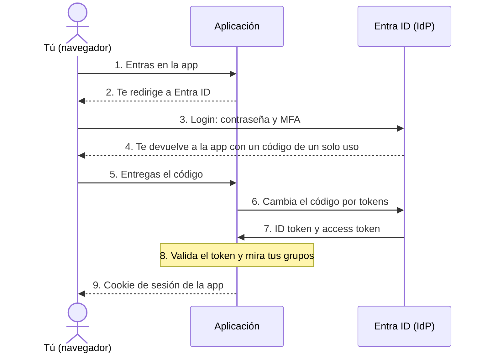

# SSO con Entra ID

Single Sign-On: inicias sesión una vez en un sitio central y entras en varias aplicaciones sin volver a escribir la contraseña. Cómo funciona, qué hace cada pieza y cómo se aplica en Databricks y AWS.

- Autenticación = quién eres
- Autorización = qué puedes hacer
- IdP = Entra ID

## Qué es SSO

SSO no es un estándar. Es el concepto de centralizar el acceso: un único proveedor de identidad comprueba quién eres y las aplicaciones confían en él. Lo implementan estándares concretos, sobre todo OpenID Connect (OIDC), OAuth 2.0 y SAML.

Lo que se gana: una sola contraseña y un solo MFA, las altas y bajas en un único sitio, y aplicaciones que no guardan contraseñas. Si alguien se va de la empresa, se desactiva en Entra ID y deja de poder iniciar sesión en todas las aplicaciones conectadas (salvo las vías alternativas que se explican [[#Quién decide qué|más abajo]]).

## Autenticación y autorización

Siempre va primero la autenticación: no se pueden decidir permisos sin saber quién eres.

### Autenticación (AuthN)

- **Pregunta:** ¿Quién eres?
- **Ejemplo:** Contraseña y MFA en Entra ID.
- **Protocolos:** OIDC, SAML.
- **Resultado:** Un ID token (OIDC) o una aserción SAML que dicen quién eres.

### Autorización (AuthZ)

- **Pregunta:** ¿Qué puedes hacer?
- **Ejemplo:** El grupo dbx-finanzas puede leer el esquema ventas.finanzas.
- **Protocolos:** OAuth 2.0 para el acceso delegado a APIs. Dentro de cada aplicación suele ser lógica propia, no un protocolo.
- **Resultado:** Un access token para llamar a APIs, o un sí o un no dentro de la aplicación.

## Las piezas

Usuario

### Tú y tu navegador

Tu navegador hace las redirecciones de un sitio a otro y guarda las cookies de cada uno.

IdP · proveedor de identidad

### Entra ID

Guarda los usuarios y los grupos, pide la contraseña y el MFA y emite los tokens. Okta o Google harían el mismo papel.

Aplicación

### Databricks, AWS, una app vuestra

Confía en el IdP, valida sus tokens, crea su propia sesión y decide los permisos finos.

En la jerga: Service Provider en SAML, Relying Party en OIDC.

## Protocolos

En la práctica casi todo es OIDC con OAuth 2.0, o SAML. SAML puede hacer las dos cosas: además de decir quién eres, lleva atributos como grupos o roles que la aplicación usa para darte permisos.

### Autenticación

- **OpenID Connect (OIDC):** El estándar moderno para SSO web y móvil. Va montado encima de OAuth 2.0 y añade el ID token.
- **SAML 2.0:** Más antiguo, basado en XML. Muy usado en SSO empresarial: AWS IAM Identity Center, Salesforce, SAP.
- **Kerberos:** El de las redes internas Windows con Active Directory. Usa tickets en vez de tokens.
- **LDAP:** Sirve para consultar directorios de usuarios, pero se usa mucho para validar usuario y contraseña.
- **RADIUS:** Para acceso a red: VPN o Wi-Fi corporativa.
- **FIDO2 / WebAuthn:** Login sin contraseña con llaves físicas, huella o passkeys.

### Autorización

- **OAuth 2.0:** El estándar para dar acceso delegado mediante tokens. Es el que más vas a ver.
- **UMA:** Extensión de OAuth para que el usuario controle quién accede a sus recursos.
- **XACML:** Lenguaje para definir reglas de permisos muy detalladas. Típico de entornos corporativos grandes.

## El flujo paso a paso

Con OIDC, que es lo más común hoy. Es el llamado flujo con código de autorización.



Líneas continuas: el paso pasa por tu navegador. Líneas discontinuas con flecha hacia la izquierda: respuestas. Los pasos 6 y 7 son la app hablando directamente con Entra ID, sin pasar por el navegador.


- **1–2:** Empiezas en la aplicación, no en el IdP. La app ve que no tienes sesión y redirige tu navegador a Entra ID. También se puede empezar desde el portal de Microsoft (myapps.microsoft.com), pero es lo menos habitual.
- **3:** Haces login en Entra ID. Solo Entra ID ve tu contraseña; la aplicación nunca.
- **4–5:** Entra ID devuelve tu navegador a la app con un código de un solo uso. El código por sí solo no sirve para entrar.
- **6–7:** La app, por detrás y sin pasar por tu navegador, llama a Entra ID y cambia ese código por los tokens: un ID token, que dice quién eres y puede incluir tus grupos o roles, y, si hace falta, un access token.
- **8:** La app comprueba que el ID token lo firmó Entra ID, que es para ella y que no ha caducado. Luego mira quién eres y qué grupos tienes.
- **9:** La app crea su propia cookie de sesión. A partir de aquí tu navegador la envía en cada petición y no hace falta volver a Entra ID hasta que caduque.

### Por qué la segunda aplicación no te pide contraseña

Entra ID también guarda su propia sesión, en una cookie suya. Cuando vas a otra aplicación, te redirige igual a Entra ID, pero como ya tienes sesión allí, te devuelve enseguida con un código nuevo sin pedirte nada. Ese es el «único inicio de sesión».

App B → Entra ID: ya tienes sesión → App B con código → Cookie de App B

## Tokens y cookie

Son tres cosas distintas. El ID token sirve para entrar, el access token para llamar a APIs y la cookie para que la app te recuerde.

OIDC

### ID token

- **Lo crea:** El IdP (Entra ID).
- **Sirve para:** Decir quién eres. Puede llevar tus grupos o roles.
- **Lo usa:** La aplicación, que lo valida para iniciar tu sesión.
- **Dura:** Poco. Solo se usa en el momento del login.

OAuth 2.0

### Access token

- **Lo crea:** El IdP, que aquí hace de servidor de autorización.
- **Sirve para:** Llamar a una API en tu nombre con ciertos permisos, por ejemplo leer tu correo en Microsoft Graph.
- **Lo usa:** La aplicación, que lo envía a la API en la cabecera `Authorization: Bearer`.
- **Dura:** En Entra ID, entre 60 y 90 minutos por defecto.

De la app

### Cookie de sesión

- **La crea:** La propia aplicación, después de validar el ID token.
- **Sirve para:** Que la app recuerde que ya iniciaste sesión.
- **La usa:** Tu navegador, que la envía en cada petición a esa app.
- **Dura:** Lo que decida la aplicación.

### ¿La cookie de sesión lleva dentro el access token?

Depende de cómo esté programada la app. Lo más habitual y recomendable es que la cookie solo lleve un identificador aleatorio de sesión y que la app guarde los tokens en su servidor, asociados a ese identificador. Algunos frameworks también permiten meter los tokens cifrados dentro de la cookie.

Lo que se evita es dejar el access token al alcance del navegador, porque quien lo robe puede usarlo hasta que caduque.

## Quién decide qué

El IdP hace la autenticación entera, pero en la autorización solo pone una parte. Los permisos finos los decide siempre la aplicación.

### Lo decide Entra ID

- Quién eres: contraseña, MFA y acceso condicional.
- Quién está en cada grupo.
- Si puedes entrar en una aplicación, asignándola solo a ciertos usuarios o grupos.
- Qué datos van dentro del token, como grupos o roles.

### Lo decide la aplicación

- Validar el token y crear la sesión.
- Qué puede hacer cada grupo dentro: qué tabla, qué cuenta, qué botón.
- Cuánto dura su sesión.
- Si ofrece vías de acceso propias, como tokens personales.

**Los grupos no son de una aplicación.** Un grupo de Entra ID es un grupo normal que asignas o sincronizas donde quieras, y el mismo grupo puede usarse en varias aplicaciones. Crear grupos por aplicación (dbx-finanzas, aws-data-dev) es una convención para tenerlo ordenado, no una obligación.

**Los grupos llegan de dos formas.** Algunas aplicaciones los sincronizan por SCIM, como Databricks y AWS. Otras los leen directamente del token en cada login, porque Entra ID puede meter grupos o roles dentro del ID token.

**Ojo con las vías alternativas.** La autenticación es entera de Entra ID mientras el acceso pase por el SSO. En Databricks, por ejemplo, los tokens personales (PAT) permiten conectarse sin pasar por Entra ID una vez creados.

## Ejemplos: Databricks y AWS

El mismo patrón en las dos. Entra ID gestiona quién está en cada grupo y la plataforma guarda la relación entre grupo y permisos.

### Databricks

1.  Entra ID

    Creáis el grupo dbx-finanzas y metéis a Ana y a Pedro.

2.  Sincronización

    El grupo y sus miembros llegan a Databricks por SCIM o con la sincronización automática de identidades de Azure Databricks.

3.  Unity Catalog

    Dais permisos al grupo, por ejemplo leer un esquema. En vuestro caso, desde Terraform. Clusters, notebooks y jobs van con los permisos del workspace.

4.  Login

    Entra ID te autentica por OIDC (el `oidcBrowserLogin` de la auditoría) y Databricks aplica los permisos de tus grupos.

Ejemplo en Terraform · nombres inventados

``` hcl
resource "databricks_grants" "finanzas" {
  schema = "ventas.finanzas"
  grant {
    principal  = "dbx-finanzas"
    privileges = ["USE_SCHEMA", "SELECT"]
  }
}
# además hace falta USE_CATALOG sobre el catálogo ventas
```

Si metes a alguien en dbx-finanzas en Entra ID, recibe esos permisos en Databricks sin tocar nada allí.

### AWS

1.  Entra ID

    Creáis el grupo aws-data-dev con sus miembros.

2.  SCIM

    El grupo y sus miembros se copian a IAM Identity Center, el nombre actual de AWS SSO.

3.  IAM Identity Center

    Asignáis grupo + permission set + cuenta. El permission set lleva las políticas IAM que definen qué puedes hacer. Estas asignaciones también se pueden llevar en Terraform.

4.  Cuenta AWS

    Cada permission set crea un rol IAM en cada cuenta donde lo asignas, con nombre tipo `AWSReservedSSO_<permission set>_<id>`.

5.  Login

    Entra ID te autentica por SAML y entras en la cuenta asumiendo ese rol.

|                        | Databricks                                              | AWS                                       |
|------------------------|---------------------------------------------------------|-------------------------------------------|
| Quién está en el grupo | Entra ID                                                | Entra ID                                  |
| Cómo llega el grupo    | SCIM o sincronización automática                        | SCIM a IAM Identity Center                |
| Dónde se dan permisos  | Unity Catalog y permisos del workspace                  | Permission sets asignados a cuentas       |
| Protocolo de login     | OIDC                                                    | SAML                                      |
| Qué obtienes al entrar | Una sesión en Databricks con los permisos de tus grupos | Un rol IAM AWSReservedSSO\_… en la cuenta |

## Ideas que se suelen confundir

| Idea                                                 | Cómo es                                                                                                                            |
|------------------------------------------------------|------------------------------------------------------------------------------------------------------------------------------------|
| SSO es un estándar.                                  | Es el concepto. Lo implementan estándares como OIDC, OAuth 2.0 y SAML.                                                             |
| OAuth 2.0 es de autenticación.                       | Es de autorización. La autenticación la añade OIDC, que va montado encima.                                                         |
| Entra ID es un mecanismo de autorización.            | Es un proveedor de identidad (IdP) que habla esos protocolos.                                                                      |
| Entra ID usa SAML u OIDC por dentro.                 | Son el idioma entre la aplicación y Entra ID. Cada aplicación se configura con uno.                                                |
| Primero voy al IdP y luego a la aplicación.          | Normalmente vas a la aplicación y ella te redirige a Entra ID.                                                                     |
| Con el access token entro en la aplicación.          | Para entrar se usa el ID token. El access token es para llamar a APIs.                                                             |
| Entra ID me da la cookie de sesión por OAuth.        | La cookie la crea la aplicación después de validar el ID token.                                                                    |
| La cookie de sesión lleva dentro el access token.    | Depende de la aplicación. Lo recomendable es que lleve solo un identificador y que los tokens se queden en el servidor.            |
| La autorización se puede delegar entera en Entra ID. | Entra ID gestiona quién está en cada grupo. Qué puede hacer cada grupo se define en la aplicación: Unity Catalog, permission sets… |

En resumen

El IdP responde a quién eres y a qué grupos perteneces. La aplicación responde a qué puedes hacer dentro. OIDC, OAuth 2.0 y SAML son el idioma en el que hablan los dos.
